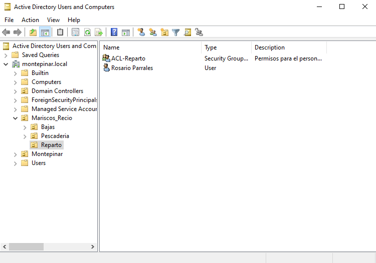
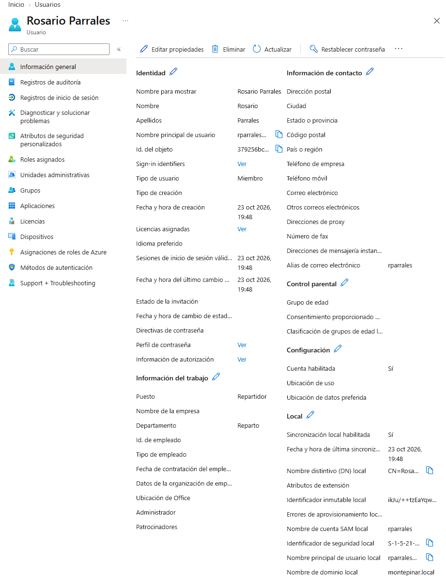
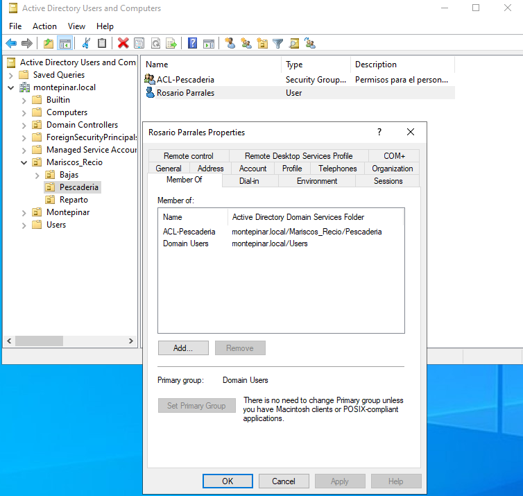
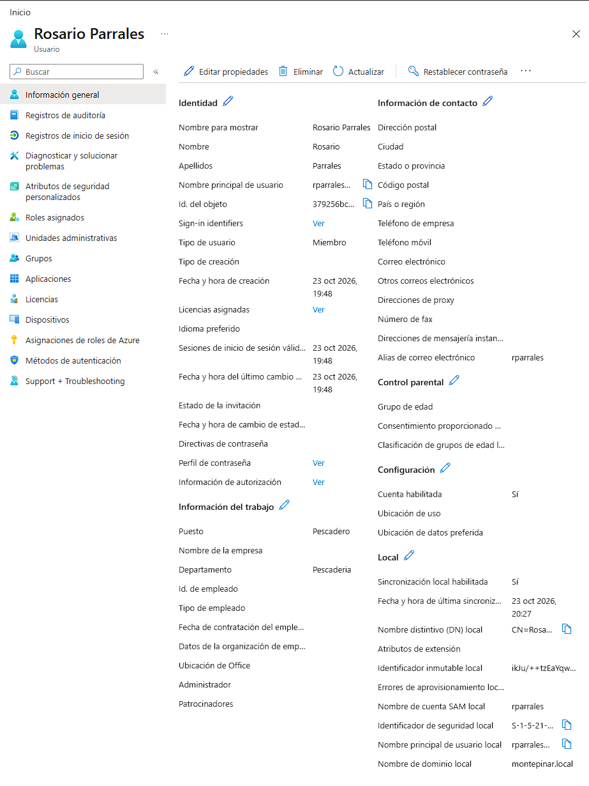
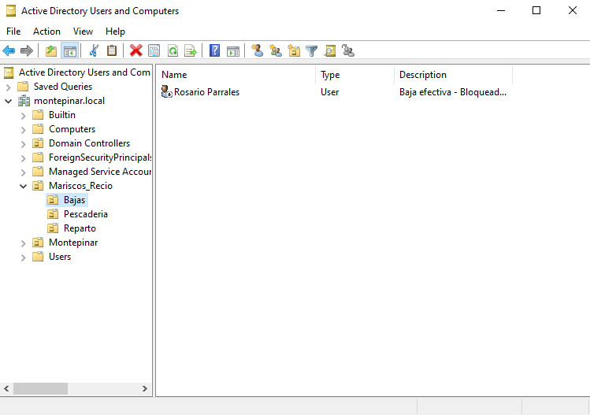

# Lab_03 Ciclo de vida (JML) - Mariscos Recio y Rosario Parrales

### 1. Descripción del proyecto
En el marco de la modernización corporativa de Mariscos Recio S.L., la dirección ejecutiva encabezada por Antonio Recio (Mayorista no limpia pescado) decide que la gestión del personal ya no puede depender de procedimientos improvisados, cambios de puesto sin control ni despidos comunicados a viva voz.

Para mejorar la administración de identidades y accesos, se plantea un procedimiento basado en el ciclo de vida JML (Joiner, Mover, Leaver), utilizando PowerShell para gestionar las identidades en Active Directory Domain Services (AD DS) y Microsoft Entra ID en un entorno híbrido.

El laboratorio utiliza como ejemplo la trayectoria de Rosario Parrales, desde su incorporación a la empresa hasta su cambio de puesto y posterior desvinculación.

Objetivos técnicos

- Automatizar las operaciones básicas del ciclo de vida de una identidad mediante PowerShell.
- Aprovisionar usuarios con atributos corporativos estandarizados.
- Gestionar el acceso a recursos mediante grupos de seguridad y un modelo de asignación basado en roles (RBAC).
- Actualizar los atributos y las pertenencias a grupos durante los cambios de puesto.
- Reducir la acumulación de permisos innecesarios (Privilege Creep).
- Deshabilitar las cuentas y retirar las pertenencias departamentales previstas en el procedimiento de baja.
- Comprender cómo se propagan los cambios de identidad desde AD DS hasta Microsoft Entra ID mediante Entra Connect Sync.
- Verificar los resultados de las operaciones y mantener evidencias útiles para la trazabilidad.
  
#### Escenario ficticio: 
Mariscos Recio S.L., donde Antonio Recio quiere que su nuevo empleado, Rosario Parrales tenga acceso solo a lo que le corresponde según su trabajo. Parrales solo trabaja media jornada, 12 horitas... 

### 2. Arquitectura y modelo de acceso

El laboratorio se apoya en la infraestructura de identidad híbrida desarrollada en el Lab 01: Despliegue de Identidad Híbrida y en los controles de acceso trabajados en el Lab 02.

La arquitectura separa dos funciones:

Unidades organizativas (OUs): permiten organizar las identidades dentro de AD DS y definir el ámbito de aplicación de las políticas de grupo (GPOs).

Grupos de seguridad: permiten agrupar usuarios según sus funciones y centralizar la asignación de permisos.

En este escenario se utilizan los siguientes grupos:

- ACL-Reparto: grupo asociado a las funciones del departamento de Reparto.
- ACL-Pescaderia: grupo asociado a las funciones del departamento de Pescadería.

La asignación de accesos se realiza mediante la pertenencia a grupos, en lugar de conceder permisos individualmente a cada usuario. Este enfoque facilita la administración de los cambios de puesto y reduce el riesgo de mantener privilegios que ya no son necesarios.

Las OUs y los grupos tienen funciones diferentes: mover una cuenta de OU no concede ni revoca automáticamente los permisos asociados a los grupos de seguridad.

### 3. Fases de implementación

## Fase 1: Joiner — Alta y aprovisionamiento de identidad 

### 1. Justificación

Mariscos Recio S.L. incorpora a Rosario Parrales como repartidor. El objetivo de esta fase es crear su identidad en AD DS, establecer los atributos corporativos correspondientes y asignarla al grupo de seguridad de su departamento.

### 2. Aprovisionamiento en Active Directory Domain Services (AD DS)
Se ejecutó un script en PowerShell automatizando la creación de la identidad en la OU correspondiente y la asignación inmediata de su rol departamental:

```powershell
# Definición de los atributos corporativos
$userParams = @{
    Name                  = "Rosario Parrales"
    GivenName             = "Rosario"
    Surname               = "Parrales"
    DisplayName           = "Rosario Parrales"
    SamAccountName        = "rparrales"
    UserPrincipalName     = "rparrales@malastro.onmicrosoft.com"
    Department            = "Reparto"
    Title                 = "Repartidor"
    Path                  = "OU=Reparto,OU=Mariscos_Recio,DC=montepinar,DC=local"
    AccountPassword       = (Read-Host "Contraseña temporal" -AsSecureString)
    Enabled               = $true
    ChangePasswordAtLogon = $true
}

# Creación de la identidad
New-ADUser @userParams

# Asignación del grupo de seguridad departamental
Add-ADGroupMember -Identity "ACL-Reparto" -Members "rparrales"
```
La contraseña temporal se introduce de forma interactiva para evitar incluirla directamente en el código del repositorio. La configuración ChangePasswordAtLogon solicita al usuario cambiarla en su primer inicio de sesión, conforme al procedimiento definido para el laboratorio.

3. Validación del alta




## Fase 2: Mover — Transición de Rol y Mitigación de Privilege Creep

### 1. Justificación Técnica
Tras una reorganización interna, Rosario Parrales deja las tareas de reparto y pasa a desempeñar funciones de pescadero en el mostrador.

Este cambio requiere actualizar sus atributos laborales y su ubicación organizativa, así como sustituir los accesos del puesto anterior por los correspondientes a su nueva función.

El objetivo es evitar el Privilege Creep: la acumulación de permisos que se produce cuando se añaden nuevas autorizaciones sin retirar las que han dejado de ser necesarias.

### 2. Actualización del puesto (Repartidor -> Pescadero)
Se mueve el objeto a la OU de Pescadería, se actualizan sus atributos y se modifica su pertenencia a los grupos de seguridad.

```powershell
# 1. Mover el objeto a la OU de Pescadería
Move-ADObject `
    -Identity "CN=Rosario Parrales,OU=Reparto,OU=Mariscos_Recio,DC=montepinar,DC=local" `
    -TargetPath "OU=Pescaderia,OU=Mariscos_Recio,DC=montepinar,DC=local"

# 2. Actualizar los atributos laborales
Set-ADUser -Identity "rparrales" `
    -Department "Pescaderia" `
    -Title "Pescadero"

# 3. Asignar el grupo correspondiente al nuevo puesto
Add-ADGroupMember -Identity "ACL-Pescaderia" -Members "rparrales"

# 4. Retirar el grupo asociado al puesto anterior
Remove-ADGroupMember -Identity "ACL-Reparto" `
    -Members "rparrales" `
    -Confirm:$false
```
El procedimiento actualiza la ubicación organizativa y los atributos de Rosario, incorpora el nuevo grupo de seguridad y retira el grupo correspondiente al puesto anterior.

### Validación del cambio de puesto




## Fase 3: Leaver — Baja, Revocación de Accesos y Principio Zero Trust

### 1. Justificación
Finalmente, Rosario Parrales abandona Mariscos Recio S.L... Aunque llegó a ser socio (al 3%), decide que lo mejor es separar sus caminos. Quién sabe si en el futuro se reencontrarán...

La baja de un empleado requiere bloquear su identidad, retirar los accesos que ya no necesita y conservar la información necesaria para la trazabilidad administrativa. El objeto no se elimina automáticamente: se mantiene en el directorio y se traslada a una OU destinada a las bajas.

Este procedimiento sigue el principio de mínimo privilegio y se alinea con el enfoque de Zero Trust. Sin embargo, el bloqueo de la cuenta de origen, la propagación del estado a la nube y la revocación de sesiones son operaciones distintas que deben evaluarse de forma diferenciada.

### 2. Desaprovisionamiento mediante PowerShell

```powershell
# 1. Deshabilitar la cuenta en Active Directory
Disable-ADAccount -Identity "rparrales"

# 2. Retirar la pertenencia al grupo departamental actual
Remove-ADGroupMember -Identity "ACL-Pescaderia" `
    -Members "rparrales" `
    -Confirm:$false

# 3. Trasladar el objeto a la OU de bajas
Move-ADObject `
    -Identity "CN=Rosario Parrales,OU=Pescaderia,OU=Mariscos_Recio,DC=montepinar,DC=local" `
    -TargetPath "OU=Bajas,OU=Mariscos_Recio,DC=montepinar,DC=local"

# 4. Registrar la información de la baja
Set-ADUser -Identity "rparrales" `
    -Description "Baja efectiva - Cuenta deshabilitada mediante procedimiento IAM"
```
Este fragmento muestra las operaciones principales de la baja. En un entorno real, el procedimiento debería comprobar las membresías de la cuenta y retirar todas las pertenencias que corresponda según una política definida, teniendo en cuenta las excepciones y los grupos que deban conservarse.

Asimismo, antes de trasladar el objeto a OU=Bajas, debe verificarse que esta OU está incluida en el ámbito de sincronización de Entra Connect Sync. Si queda fuera del filtrado, el movimiento puede provocar que el objeto deje de sincronizarse en lugar de transmitir únicamente su estado deshabilitado.

### 3. Validación de la baja




Resultado esperado: la cuenta de origen queda deshabilitada y se retiran los accesos departamentales previstos. El estado final en Entra ID debe comprobarse tras la sincronización; no se presupone que el cambio sea instantáneo ni que el bloqueo de la cuenta revoque por sí solo todas las sesiones ya emitidas.

## 4. Conclusiones y Competencias Demostradas

1. **Gobernanza de Identidades Híbridas:** Despliegue y configuración del conector Microsoft Entra Connect, controlando el filtrado de Unidades Organizativas (OUs) autoritativas y forzando ciclos de sincronización delta mediante PowerShell.
2. **Implementación Estricta de RBAC:** Desacoplamiento entre la estructura jerárquica del directorio (OUs para categorización y políticas) y los grupos de seguridad globales para asignación granular de privilegios.
3. **Mitigación Activa de Privilege Creep:** Demostración práctica de cómo un proceso de movilidad interna (Mover) debe incluir la revocación inmediata de pertenencia a grupos departamentales anteriores.
4. **Postura Zero Trust en Procesos de Salida (Leaver):** Aislamiento en OU de cuarentena, revocación completa de membresías y bloqueo de credenciales sincronizado inmediatamente con la nube para neutralizar el riesgo de cuentas huérfanas (*dormant accounts*).ç

## 5. Posibles mejoras futuras

- Unificar las tres fases en un script reutilizable con parámetros para cada operación.
- Incorporar un fichero CSV como fuente de datos para gestionar altas, cambios de puesto y bajas.
- Añadir validaciones previas y posteriores para detectar cuentas inexistentes, grupos incorrectos o estados inconsistentes.
- Implementar registro estructurado de operaciones y manejo de errores.
- Ampliar la gestión de membresías para contemplar grupos adicionales y excepciones documentadas.
- Verificar la propagación de los cambios en Microsoft Entra ID y estudiar la revocación de sesiones cuando proceda.
- Explorar Microsoft Graph PowerShell para automatizar comprobaciones adicionales en la nube.

El objetivo final es evolucionar desde la ejecución de comandos individuales hacia un procedimiento JML reproducible, verificable y preparado para ampliarse con nuevas capacidades de automatización IAM. 


